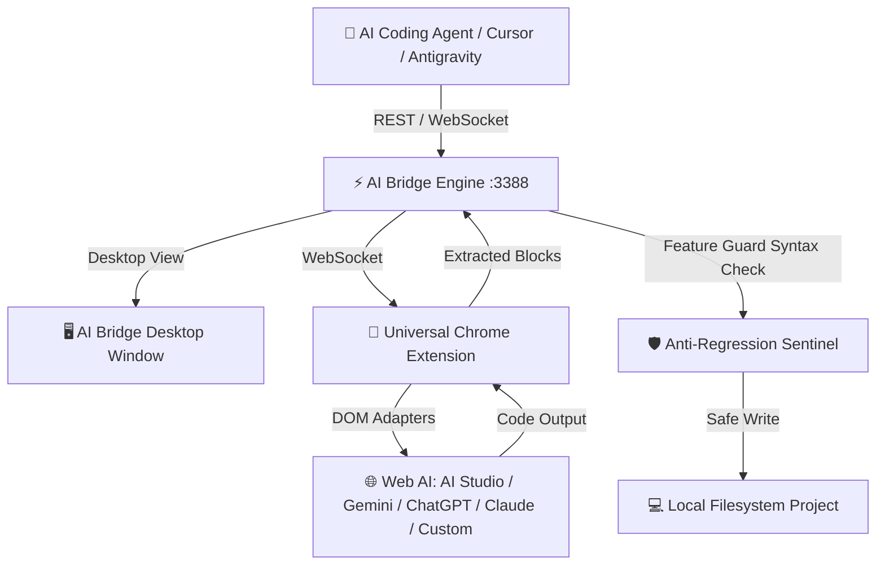

# ⚡ AI Bridge

> **Universal Web AI Superconnector & Desktop Agent Sidecar**  
> Connect your local AI coding agents (Google Antigravity, Cursor, Windsurf, Claude Code, Aider, CLI) directly with **Google AI Studio, Gemini Web, ChatGPT, and Claude** without paying for API keys.

[](https://opensource.org/licenses/MIT)
[](https://nodejs.org/)
[](https://www.electronjs.org/)
[](https://developer.chrome.com/docs/extensions/mv3/)
[]()

---

## 🌟 Why AI Bridge?

AI coding agents and developers often hit strict API rate limits or accumulate steep token bills. At the same time, frontier web interfaces like **Google AI Studio (App Builder & Playground)**, **Gemini Web**, **ChatGPT**, and **Claude** offer massive context windows and state-of-the-art reasoning for free with standard accounts.

**AI Bridge bridges that gap:**
1. **Zero API Key Requirement:** Relies on your active browser sessions in Google Chrome.
2. **Native Desktop Software:** Runs as a standalone desktop app — no terminal commands required after setup.
3. **Multi-Target Web LLM Support:** Easily dispatch tasks to **Google AI Studio App Builder** (`aistudio.google.com/apps`), **AI Studio Playground**, **Gemini Web**, **ChatGPT**, **Claude**, or **any custom web chat link**.
4. **Local Filesystem First (100% Free):** Works out-of-the-box on your local computer's project directories. No server or VPS needed!
5. **Universal Agent Sidecar:** Provides a lightweight REST API and WebSocket stream on `localhost:3388` that any external agent or CLI script can control autonomously.
6. **Anti-Regression Feature Guard:** Automatically checks generated code before applying changes, scanning for functions, React hooks, routes, and components to prevent accidental drops or truncations.

---

## 🏗️ Architecture



---

## 🚀 Quickstart (3 Steps)

### Step 1: Install & Launch Desktop App
```bash
git clone https://github.com/your-username/ai-bridge.git
cd ai-bridge
npm install
npm start
```
Or simply double-click **`AiBridge.bat`** (or **`AiBridge.vbs`** for completely silent background launch without a console window).

### Step 2: Load the Chrome Extension (2 Minutes)
1. Open Google Chrome and visit `chrome://extensions`.
2. Toggle on **Developer mode** in the top-right corner.
3. Click **Load unpacked** in the top-left corner.
4. Select the `extension/` directory inside this repository.
5. The extension badge in your Chrome toolbar will turn **ON** in green.

### Step 3: Dispatch Coding Tasks!
- Open the AI Bridge desktop window.
- Select your target AI (e.g. **Google AI Studio App Builder**).
- Type your prompt or select workspace files from the **File Explorer** tab.
- Click **Dispatch to Web LLM** ⚡.

---

## 🌐 Supported Web Chat Targets

| Target Platform | URL Preset | Supported Features |
|---|---|---|
| **Google AI Studio (App Builder)** | `https://aistudio.google.com/apps` | Full App Builder generation, Gemini 2.5 Pro reasoning |
| **Google AI Studio (Playground)** | `https://aistudio.google.com/prompts/new_chat` | Massive context, `Ctrl+Enter` execution |
| **Google Gemini Web** | `https://gemini.google.com/app` | Reasoning mode, image & screenshot attachments, native retry |
| **ChatGPT (OpenAI)** | `https://chatgpt.com` | GPT-4o / o1 reasoning, markdown code extraction |
| **Claude (Anthropic)** | `https://claude.ai/new` | Artifact extraction, ProseMirror editor support |
| **Custom Web Link** | *Any URL (DeepSeek, Perplexity, etc.)* | Universal DOM adapter with synthetic clipboard paste |

---

## 🤖 Connecting External AI Agents

Any coding assistant (Google Antigravity, Cursor, Windsurf, Claude Code, Aider, or custom shell scripts) can use AI Bridge as a sidecar.

### 1. Dispatch a Task via cURL
```bash
curl -X POST http://localhost:3388/api/task/dispatch \
  -H "Content-Type: application/json" \
  -d '{
    "goal": "Implement a secure JWT authentication middleware with refresh token rotation",
    "chatUrl": "https://aistudio.google.com/apps"
  }'
```

### 2. Retrieve Generated Results
```bash
curl http://localhost:3388/api/handoff/latest
```

### 3. Apply Code Block Directly with Feature Guard
```bash
curl -X POST http://localhost:3388/api/apply/codeblock \
  -H "Content-Type: application/json" \
  -d '{
    "targetPath": "src/middleware/auth.js",
    "code": "/* Generated code here */"
  }'
```

---

## 🛡️ Anti-Regression Feature Guard

When updating existing code, web models can occasionally truncate files or drop helper functions. AI Bridge's **Feature Guard** sentinel:
- Parses both existing and updated files for function signatures, React hooks, imports, components, and API routes.
- Calculates an exact preservation score.
- Rejects changes that drop more than 30% of existing functionality without replacement.
- Runs `node --check` syntax validation before writing to disk.

---

## 🔒 Security & Privacy Guarantee

- **100% Local:** Runs entirely on your local machine (`localhost:3388`).
- **Zero Hardcoded Secrets:** No server IP addresses, passwords, or personal credentials exist in this repository.
- **Gitignored Configurations:** `config.json` and `.env` are strictly excluded from source control.
- **No Telemetry:** No analytics or third-party reporting.

---

## 📄 License

Distributed under the **MIT License**. See `LICENSE` for more information.
